<!-- GENERATED from the paper's sources; edit those, not this file. -->
# minimax-lapse

**What this is:** A minimax theorem for the local energy densities of a closed quantum system, checked on a ring of qubits by two semidefinite programs and exact diagonalization, with its physical readings kept apart from its claims.

**What it claims or forbids:** The least achievable maximum of a closed quantum system's local energy densities equals the greatest lowest eigenvalue of its Hamiltonian reweighted by place, and the weights attaining it vanish wherever a place's density falls short of that value. A deepened place drops out exactly when the other places, optimized without it, already hold it at or below their common value; on a ring of 6 qubits that happens at depth 0.295.

**What it is not:** Like the lapse of canonical gravity, which a slicing condition fixes, these weights are fixed by a rule for dividing the energy among the places, one that names no place; once it is applied, the energies fix them.

**Five-minute check:** With Python 3.14 or later and `make`, in a fresh virtual environment: `python3.14 -m venv .venv`, then `source .venv/bin/activate`, then `pip install -e ".[dev]"`, then `make reproduce GRADE=paper EXP=ring`. It reruns the experiment the headline numbers come from and checks it against the stored results that hold them: the common value on the uniform ring, −1.28790; and the depth at which a deepened cell drops out, 0.295.

**Relations to other work:**

- *Builds on:* the minimax theorem, which equates the two orders of optimization [vonNeumann1928](https://doi.org/10.1007/BF01448847); the minimax theorem in the generality used, on compact convex sets [Sion1958](https://doi.org/10.2140/pjm.1958.8.171); the history of the conditions for optimization under inequality constraints, from Karush to Kuhn and Tucker [GiorgiKjeldsen2014](https://doi.org/10.1007/978-3-0348-0439-4_1); the derivatives of a max-min value, which make the weights the rates at which the common value moves [Danskin1966](https://doi.org/10.1137/0114053); the standard statement of the duality, conditions, sensitivities and semidefinite programs used [BoydVandenberghe2004](https://doi.org/10.1017/CBO9780511804441); the 3+1 formalism, in which the lapse is the rate of proper time between slices and a slicing condition fixes it [Gourgoulhon2007](https://arxiv.org/abs/gr-qc/0703035); maximum entropy under constraints on expectations, whose multipliers are the coldest equilibrium's local inverse temperatures [Jaynes1957](https://doi.org/10.1103/PhysRev.106.620); maximum entropy for density matrices, which gives the coldest equilibrium its thermal form in the local energies [Jaynes1957b](https://doi.org/10.1103/PhysRev.108.171); optimizing an extreme eigenvalue of an affine family of symmetric matrices, the form of the right side of the saddle [Overton1988](https://doi.org/10.1137/0609021); the theory of optimizing eigenvalues of symmetric matrices, and its route to semidefinite programming [LewisOverton1996](https://doi.org/10.1017/S0962492900002646); the method: a Gaussian state's entanglement Hamiltonian from its correlations [Peschel2003](https://arxiv.org/abs/cond-mat/0212631); the history Hamiltonian, a computation held as one stationary state [Feynman1986](https://doi.org/10.1007/BF01886518); the history state's ground space and gap [KitaevShenVyalyi2002](https://doi.org/10.1090/gsm/047).
- *Compares with:* the lapse of canonical gravity, a freely chosen multiplier, against which the weights are read [ArnowittDeserMisner2008](https://arxiv.org/abs/gr-qc/0405109); the origin of reading multipliers of resource bounds as prices, which the shadow-price reading of the weights draws on [Kantorovich1960](https://doi.org/10.1287/mnsc.6.4.366); a chosen slicing whose slices stop short of a black hole's singularity, the nearest picture to a place whose clock stops [EstabrookEtAl1973](https://doi.org/10.1103/PhysRevD.7.2814); the cosmological constant as one global quantity of the whole spacetime, against which the common value is read [HenneauxTeitelboim1989](https://doi.org/10.1016/0370-2693(89)91251-3); equilibrium in a static gravitational field, governed by local energies weighted by the lapse, against which the weights' lapse role is set [Tolman1930](https://doi.org/10.1103/PhysRev.35.904); a closed system in a stationary state whose dynamics are read from its own clocks, the premise of the clock reading [PageWootters1983](https://doi.org/10.1103/PhysRevD.27.2885); measured entanglement-Hamiltonian temperature profiles of a 51-ion XXZ chain, the published data the entanglement profile now holds [JoshiEtAl2023](https://doi.org/10.1038/s41586-023-06768-0); entanglement-Hamiltonian tomography, which measures a part of a quantum simulator as weighted local terms, the method behind the measured profile [KokailEtAl2021](https://doi.org/10.1038/s41567-021-01260-w); the lower bound on a ground energy from the least energies of local pieces, the saddle's nearest many-body relative [Anderson1951](https://doi.org/10.1103/PhysRev.83.1260); a weighting of an open chain's local terms by place, chosen to make its ground state a ring's, set against the saddle's weighting [HikiharaNishino2011](https://arxiv.org/abs/1012.0472); entanglement Hamiltonians realized as Hamiltonians with spatially varying couplings, a weighting of local terms by place in practice [DalmonteVermerschZoller2018](https://arxiv.org/abs/1707.04455); the thermal time hypothesis, in which the state, not a clock outside, fixes the flow of time [ConnesRovelli1994](https://doi.org/10.1088/0264-9381/11/12/007); Tolman's relation derived from thermal time, temperature the rate of thermal time against proper time [RovelliSmerlak2011](https://doi.org/10.1088/0264-9381/28/7/075007); couplings that vary in space acting on a critical chain as a curved metric [DubailEtAl2017](https://doi.org/10.21468/SciPostPhys.2.1.002); a lattice whose couplings fall to zero along a line, built to simulate a field near a horizon [RodriguezLagunaEtAl2017](https://doi.org/10.1103/PhysRevA.95.013627); semidefinite relaxations giving lower bounds on the ground energies of local Hamiltonians [BarthelHubener2012](https://doi.org/10.1103/PhysRevLett.108.200404); lower bounds on ground energies from positivity of moment matrices, a semidefinite program [BaumgratzPlenio2012](https://doi.org/10.1088/1367-2630/14/2/023027); the finite-size term of a critical chain's ground energy, set by the central charge and the speed [BloteCardyNightingale1986](https://doi.org/10.1103/PhysRevLett.56.742); the same finite-size term, tied to the conformal anomaly [Affleck1986](https://doi.org/10.1103/PhysRevLett.56.746); an interval's entanglement entropy on a finite critical ring, the second relation for the central charge [CalabreseCardy2004](https://arxiv.org/abs/hep-th/0405152); the 2 pi of a horizon: the vacuum restricted to a wedge is thermal in the boost generator at 2 pi, a generator weighting local energy by the distance to the horizon [BisognanoWichmann1976](https://doi.org/10.1063/1.522898); an interval's modular Hamiltonian in a conformal field theory, with the profile (R^2 - x^2)/(2R) times 2 pi [CasiniHuertaMyers2011](https://arxiv.org/abs/1102.0440); the temperature of the de Sitter horizon, its surface gravity over 2 pi [GibbonsHawking1977](https://doi.org/10.1103/PhysRevD.15.2738); Bell's theorem, whose assumptions the records reading factors [Bell1964](https://doi.org/10.1103/PhysicsPhysiqueFizika.1.195); the CHSH combination, Eq. chsh [ClauserEtAl1969](https://doi.org/10.1103/PhysRevLett.23.880); the bound 2 sqrt 2 when only readings of different parts commute [Tsirelson1980](https://doi.org/10.1007/BF00417500); Bell inequalities as the condition for one joint description [Fine1982](https://doi.org/10.1103/PhysRevLett.48.291); non-locality as the failure of local sections to glue into a global one [AbramskyBrandenburger2011](https://arxiv.org/abs/1102.0264); the contextual fraction, the share that cannot glue, as a linear program [AbramskyBarbosaMansfield2017](https://arxiv.org/abs/1705.07918); a Wigner's-friend extension of Bell's theorem against observer-independent facts [Brukner2018](https://arxiv.org/abs/1804.00749); local friendliness: absolute outcomes, local agency and independent settings bound the friends' correlations [BongEtAl2020](https://arxiv.org/abs/1907.05607); the lattice entanglement Hamiltonian's continuum limit, reached once the longer-range hoppings are counted, the way the interval's weights are read here [EislerTonniPeschel2019](https://arxiv.org/abs/1902.04474); clocks inside a constrained whole that read time dilation by conditioning on one another [SmithAhmadi2020](https://arxiv.org/abs/1904.12390); the equivalence of three formulations of relational quantum dynamics, among them the conditioning on a clock used here [HoehnSmithLock2021](https://arxiv.org/abs/1912.00033); one master constraint in place of gravity's local Hamiltonian constraints [Thiemann2006](https://arxiv.org/abs/gr-qc/0305080); the convex set of local expectation values over all states, whose geometry signals symmetry breaking [ZaunerEtAl2016](https://arxiv.org/abs/1412.7642); maximum-entropy inference from local expectations, and its discontinuity at transitions [ChenEtAl2015](https://arxiv.org/abs/1406.5046); the measured post-Newtonian gamma, against which a lapse over flat cells is set [BertottiIessTortora2003](https://doi.org/10.1038/nature01997); when energy can be extracted locally from a strongly coupled ground state, characterized by semidefinite programs [AlhambraEtAl2019](https://arxiv.org/abs/1902.02357); zero-point energy of an entangled many-body ground state extracted by local operations conditioned on a distant measurement [Hotta2011](https://arxiv.org/abs/1101.3954).

**Keywords:**

- *Quantum many-body:* local energy density; local Hamiltonian; ground state; closed quantum system.
- *Optimization:* minimax theorem; semidefinite programming; complementary slackness; shadow price.
- *Gravitation:* lapse function; canonical gravity.

## The result

The least achievable maximum of a closed quantum system's local energy densities is a saddle. It equals the greatest lowest eigenvalue of the Hamiltonian reweighted by place, a place carries weight only where its density reaches the common value, and, under a premise stated with them, the same weights hold a static lapse's place: the saddle state is stationary under the evolution they weight, each weighs its place's energy in the common value as a lapse weighs local energy seen from far away, and they vanish wherever a place falls short. A deepened place drops out exactly when the others, optimized without it, already hold it at or below their common value; on a ring of 6 qubits that happens at depth 0.295. Across 120 models in 3 families on 6 lattices the general claims hold in every one, and where magnetization is conserved a deep cell never drops out of an even ring in a weak field, to first order in it, and did on every odd ring of the study of size. So one weighting certifies how low every local energy can be held and names the places that hold it up, and the same weighting is a lapse that the energies, once divided among the places, fix by themselves, zero wherever a place falls short. Each claim and the test that carries it are in [CLAIMS.md](CLAIMS.md).

## Grades

The same code runs at widening breadth, and each grade's results are stored with the machine and the time they took:

| Grade | What it runs | Command |
| --- | --- | --- |
| quick | small cases of every experiment, for a first check | `make reproduce` |
| paper | the ring of the paper | `make run GRADE=paper` |
| survey | the catalogue of kinds of model, and the study of size, that the paper reports | `make run GRADE=survey` |
| certification | a wider catalogue, with more parameters, seeds and placements at the same small sizes, and the study of size taken to larger rings | `make run GRADE=certification` |

## Breadth

The catalogue the paper reports, by kind of model. Every general claim holds in every model; the last two columns concern a deepened cell, how often it drops out and the largest weight it keeps where it does not.

| Pieces | Lattice | Cells | Parameters | Models | Places below | Drops out | Weight kept |
| --- | --- | :---: | --- | ---: | ---: | ---: | ---: |
| Ising | ring | 3–5 | g = 0.5, 1, 2, J = 1; g = 0.5, 1, 2, J = −1; g = 0.5, 1, 2, J = 1, b = 0.5 | 27 | 0 | 27 of 27 | — |
| Ising | open chain | 3–5 | g = 0.5, 1, 2; J = 1; deepening an end or the middle | 18 | 18 | 9 of 9 | — |
| Ising | two-leg ladder | 6 | g = 0.5, 1, 2; J = 1 | 3 | 2 | 3 of 3 | — |
| Ising | complete graph | 4–5 | g = 0.5, 1, 2, J = 1; g = 0.5, 1, 2, J = −1 | 12 | 0 | 12 of 12 | — |
| Ising | star | 4–5 | g = 0.5, 1, 2; J = 1; deepening the hub or a leaf | 12 | 6 | 6 of 6 | — |
| XXZ | ring | 3–5 | Δ = −0.5, 0.5, 1.5; J = 1; b = 0.2 | 9 | 0 | 5 of 9 | 0.029 |
| XXZ | open chain | 3–5 | Δ = −0.5, 0.5, 1.5; J = 1; b = 0.2; deepening an end or the middle | 18 | 9 | 8 of 15 | 0.073 |
| XXZ | star | 4–5 | Δ = −0.5, 0.5, 1.5; J = 1; b = 0.2; deepening the hub or a leaf | 12 | 6 | 6 of 6 | — |
| random | random graph | 3–5 | 3 draws | 9 | 15 | 3 of 5 | 0.041 |
| All |  | 3–6 |  | 120 | 56 | 79 of 92 | 0.073 |

## The equations in the code

Every labelled equation of the paper is computed by the function named here, whose docstring states the equation, and checked by a test that reaches the same result another way; the first line of each test says how. Every model is stated in the paper's appendix on the models.

| Equation | Computed by | Checked by |
| --- | --- | --- |
| eq:density | [`saddle.model.densities`](src/saddle/model.py#L23) | `test_densities_split_the_hamiltonian` |
| eq:saddle | [`saddle.programs.greatest_least`](src/saddle/programs.py#L48); [`saddle.programs.least_greatest`](src/saddle/programs.py#L31) | `test_both_sides_meet_a_search_over_weightings` |
| eq:conditions | [`saddle.programs.residuals`](src/saddle/programs.py#L75) | `test_conditions_hold_at_a_saddle_built_by_hand` |
| eq:certificate | [`saddle.programs.certificate`](src/saddle/programs.py#L91) | `test_every_weighting_bounds_every_state` |
| eq:gain | [`saddle.programs.reweighting_gain`](src/saddle/programs.py#L138) | `test_gain_measures_what_reweighting_adds` |
| eq:clockrate | [`saddle.probes.clock_rate`](src/saddle/probes.py#L24) | `test_clocks_run_at_their_weights_in_the_joint_evolution` |
| eq:redshift | [`saddle.probes.global_energy`](src/saddle/probes.py#L38) | `test_an_excitation_adds_its_weight_times_its_energy` |
| eq:tolman | [`saddle.probes.local_temperature`](src/saddle/probes.py#L31) | `test_thermometers_read_tolman_in_the_joint_equilibrium` |
| eq:optical | [`saddle.experiments.space.optical_time`](src/saddle/experiments/space.py#L60) | `test_the_optical_time_on_a_linear_lapse` |
| eq:vacuum | [`saddle.experiments.space.vacuum_entropy`](src/saddle/experiments/space.py#L169) | `test_the_vacuum_entropy_follows_the_free_fermions_on_the_uniform_chain` |
| eq:interval | [`saddle.experiments.bump.interval_entropy`](src/saddle/experiments/bump.py#L206) | `test_the_interval_entropy_follows_the_free_fermions_on_the_uniform_ring` |
| eq:phase | [`saddle.probes.phase_rate`](src/saddle/probes.py#L45) | `test_the_saddle_state_turns_at_the_common_value` |
| eq:casimir | [`saddle.experiments.critical.size_set_part`](src/saddle/experiments/critical.py#L59) | `test_the_size_set_part_is_the_conformal_term` |
| eq:chord | [`saddle.experiments.critical.chord`](src/saddle/experiments/critical.py#L65) | `test_the_chord_carries_the_entropy` |
| eq:moment | [`saddle.experiments.patch.moment_weights`](src/saddle/experiments/patch.py#L69) | `test_the_first_moment_is_the_long_wave_slope` |
| eq:patch | [`saddle.experiments.patch.profile`](src/saddle/experiments/patch.py#L85) | `test_the_profile_has_slope_two_pi_over_v_at_its_edge` |
| eq:desitter | [`saddle.experiments.patch.desitter_temperature`](src/saddle/experiments/patch.py#L91) | `test_the_desitter_temperature_by_the_cosmological_constant` |
| eq:chsh | [`saddle.experiments.records.chsh`](src/saddle/experiments/records.py#L43) | `test_the_chsh_value_is_the_bell_operators` |
| eq:history | [`saddle.experiments.records.history_hamiltonian`](src/saddle/experiments/records.py#L120) | `test_the_history_hamiltonian_is_a_path_laplacian_in_the_steps_frame` |
| eq:entanglement | [`saddle.entropy.entanglement_weights`](src/saddle/entropy.py#L48) | `test_fitting_recovers_the_weights_a_state_was_built_from` |
| eq:canonical | [`saddle.model.components`](src/saddle/model.py#L173) | `test_the_components_are_the_pauli_strings_on_each_set` |
| eq:evolution | [`saddle.programs.weighted`](src/saddle/programs.py#L97); [`saddle.programs.weighted_from_pieces`](src/saddle/programs.py#L103) | `test_weighted_hamiltonian_two_ways_and_its_stationary_state` |
| eq:curvature | [`saddle.programs.floor_hessian`](src/saddle/programs.py#L145) | `test_the_floor_curves_as_its_second_differences_say` |
| eq:rates | [`saddle.programs.rate_bounds`](src/saddle/programs.py#L111) | `test_rates_are_the_one_sided_differences` |
| eq:uniform | [`saddle.programs.uniform_value`](src/saddle/programs.py#L182) | `test_uniform_value_is_what_the_programs_find` |
| eq:freefloor | [`saddle.experiments.bump.free_floor`](src/saddle/experiments/bump.py#L78) | `test_the_free_floor_is_the_spin_rings_lowest_level` |
| eq:dropout | [`saddle.programs.drop_depth`](src/saddle/programs.py#L188) | `test_drop_depth_is_where_the_common_value_stops_moving` |
| eq:law | [`saddle.laws.even_ring_limit`](src/saddle/laws.py#L31) | `test_susceptibilities_match_finite_differences`; `test_even_ring_law_matches_its_limit` |
| eq:depth | [`saddle.experiments.depths.depth_from_others`](src/saddle/experiments/depths.py#L65) | `test_the_closed_form_depth_is_where_the_full_saddle_drops_the_cell` |
| eq:probes | [`saddle.probes.probed_level`](src/saddle/probes.py#L17) | `test_probes_leave_the_weights_where_they_were` |
| eq:conditioned | [`saddle.experiments.timeless.conditioned`](src/saddle/experiments/timeless.py#L46) | `test_the_conditioned_rest_evolves_under_the_weighted_generator` |
| eq:coldest | [`saddle.entropy.coldest_shape`](src/saddle/entropy.py#L40) | `test_coldest_equilibria_approach_the_saddle_weights` |
| eq:sites | [`saddle.model.on_site`](src/saddle/model.py#L17); [`saddle.model.two_site`](src/saddle/model.py#L56) | `test_site_operators_act_bit_by_bit` |
| eq:ising | [`saddle.model.ising_pieces`](src/saddle/model.py#L94); [`saddle.model.ring`](src/saddle/model.py#L39) | `test_ising_pieces_are_the_stated_ones` |
| eq:xxz | [`saddle.model.xxz_pieces`](src/saddle/model.py#L102) | `test_xxz_pieces_are_the_stated_ones` |
| eq:random | [`saddle.model.random_pieces`](src/saddle/model.py#L114) | `test_random_pieces_follow_the_stated_draws` |
| eq:lattices | [`saddle.model.lattice`](src/saddle/model.py#L63) | `test_lattices_have_the_stated_links` |
| eq:deepen | [`saddle.model.deepen`](src/saddle/model.py#L128); [`saddle.model.ring`](src/saddle/model.py#L39) | `test_deepening_moves_only_the_deep_cell` |

## Data

One published measurement is set beside the readings: the entanglement Hamiltonian learned from a trapped-ion XXZ chain, whose weights are multipliers on local energies, the kind of object the saddle weights are. Near the cut its profile has the shape of a lapse vanishing at a horizon. It does not test the claims; that would take every local term of a known Hamiltonian measured site by site, on a system small enough for its floor to be computed.

| Data | Role | Bears on | Standing |
| --- | --- | --- | --- |
| Measured entanglement-Hamiltonian weights of a subsystem at the end of a 51-ion chain, bond by bond (JoshiEtAl2023) | correspondence | Tolman temperature, horizon | fixed by comparison |

## What is taken as given

| Taken as given | Type | Enters | Note |
| --- | --- | --- | --- |
| the pieces on cells and links and their couplings $g$, $J$, $b$, $\Delta$, and the depths $\mu$ | content | eq:ising, eq:xxz, eq:random, eq:deepen | The propositions hold for any pieces; the numbers are for the models stated. |
| each link's piece split equally between its two ends, each place given its own piece: the canonical division, a rule that names no place | definition (open) | eq:density, eq:evolution | The saddle's general propositions hold for any densities, and the uniform value for any split that sums to the Hamiltonian; Eq. (A1)'s form, the propositions stated for the models, and every number use this one. |
| one qubit on each cell | content | eq:sites |  |
| energies in the models' own units, weights summing to one, rates in units of the probes' frequency | convention | none | With the weights summing to one, only their ratios carry physics: an absolute rate or temperature is read in this normalization. |
| the kick that starts the open chain's signal, a small rotation of the first interior cell; the departure at which a density counts as moved; and the window a density is watched over | setting | eq:evolution | The crossing times scale with the window's resolution only; the exponent and the bound on what moves beyond the kicked cell do not depend on the kick's size. |
| the random family's coefficients and the random graphs' links, from seeded generators | sample | eq:random, eq:lattices | A choice of instances; nothing in the system is drawn. |
| the gaps above the floor at which coldest equilibria are computed | setting | none |  |
| the solvers' tolerances, the tolerance on the other places' common value, the no-weight thresholds, and the margin by which a place counts as below the common value | setting | none | Each tolerance's and threshold's effect is printed as a bound beside the number it affects; the margin is printed where it sorts the places. |
| the weightings chosen by hand for the spatial reading, the packets' widths, the step's weight and the levels a packet is timed between, and the variation of the couplings around the rings whose saddles are computed | setting | eq:optical, eq:vacuum, eq:interval, eq:freefloor |  |
| the prepared states the data's measurements are of | state | none | The published experiment's: the ground and excited states of a trapped-ion chain whose entanglement profile the data hold. |
| the measured Hubble rate and dark-energy fraction, with their 68% uncertainties, from the Planck 2018 cosmological parameters | content | eq:desitter | Published values, carried with their uncertainties to the de Sitter temperature; the paper's object fixes none of them. |

## Where each result holds

| Claim | Needs | Holds where | When a need is dropped |
| --- | --- | --- | --- |
| Prop. prop:canonical | finitely many places, each with a finite-dimensional space of its own | everywhere it is stated | not examined |
| Prop. prop:unique | a division linear in the Hamiltonian; unchanged by a change of basis at any place; each part given only to its places; each part shared alike among its places | everywhere it is stated | not examined |
| Prop. prop:exchange | finitely many places, each density Hermitian; states ranging over all density matrices, mixed ones included | everywhere it is stated | not examined |
| Cor. cor:crossing | each density its place's own piece and half of every link piece at it | everywhere it is stated | not examined |
| Prop. prop:division | densities that sum to the Hamiltonian; finitely many places | everywhere it is stated | not examined |
| Prop. prop:uniform | a unitary carrying every density to the next place's around a ring | everywhere it is stated | Without the shift around the ring: The open chain of 6 cells has none: its common value is −1.118, its ground energy per cell −1.216.. |
| Prop. prop:dropout | a deepening that changes only the deepened place's own density | exact; computed to a tolerance moving the six-cell ring's depth by less than 0.001 | not examined |
| Prop. prop:parity | couplings conserving the magnetization and unchanged by a global spin flip; a weak uniform field; an even ring, the other cells' optimal state unique in the sector of zero magnetization; for the law, the field-off links weighted by the limiting weights with a unique ground state at zero magnetization, their floor peaking only at zero deep field; not checked here | to first order in the field; at depth 8 the law's gap is mostly the finite depth's, all of it on 4 cells, and on 6 what is left grows with the field | Without conservation of the magnetization: A transverse field of up to 0.3 on every cell breaks it, and the even ring's deepened cell still drops out at no depth sampled: not shown needed.. |
| Prop. prop:conditioned | the whole stationary under the weighted generator plus the clock's own energy; the clock's energy acting on the clock alone | everywhere it is stated | not examined |
| Prop. prop:factorization | readings self-adjoint with square one; each reading of one part commuting with each of the other's; for the bound 2, all four readings commuting | everywhere it is stated | not examined |
| Prop. prop:history | unitary steps; a unit starting state | everywhere it is stated | not examined |
| Prop. prop:coldest | some optimal weighted Hamiltonian not a multiple of the identity; a unique optimal weighting, or a symmetry leaving only one optimal weighting unchanged, for the limit to be one point | as the bound reaches the floor; 0.001 above it the proportions are within 0.022 of the weights | Without some optimal weighted Hamiltonian not a multiple of the identity: With every density a multiple of the identity the multipliers stay below 10⁻⁹ at every bound.. |
| Prop. prop:single | a single lowest state of the weighted Hamiltonian at the optimum; negative curvature along the weightings that move only the places at the common value | met in 118 of 240 catalogue cases, each model before and after deepening, and on the readings' ring before its drop-out and, within the deepened spin's sector, past it | not examined |
| Cor. cor:symmetric | the coldest equilibrium's hypothesis; a unitary mapping the densities onto one another; the densities with the identity linearly independent | on the open chain the proportions' ends rise to 0.405 at the nearest bound computed | not examined |

## How the results depend on each other

Each claim points at the claims it uses, and each reading at the claims it reads.

```mermaid
graph BT
  saddle_exchange([saddle.exchange])
  saddle_conditions([saddle.conditions])
  saddle_certificate([saddle.certificate])
  saddle_forbids([saddle.forbids])
  saddle_rates([saddle.rates])
  uniform_exact([uniform.exact])
  programs_real([programs.real])
  ring_uniform[ring.uniform]
  ring_threshold[ring.threshold]
  ring_rates[ring.rates]
  catalogue_general[catalogue.general]
  catalogue_deep[catalogue.deep]
  scaling_ising[scaling.ising]
  scaling_xxz[scaling.xxz]
  saddle_evolution([saddle.evolution])
  evolution_conditioned([evolution.conditioned])
  timeless_rates[timeless.rates]
  critical_charge[critical.charge]
  division_any([division.any])
  division_canonical([division.canonical])
  patch_profile[patch.profile]
  division_unique([division.unique])
  bell_factorization([bell.factorization])
  history_conditioning([history.conditioning])
  records_gluing[records.gluing]
  records_chsh[records.chsh]
  scaling_weighting[scaling.weighting]
  signals_wall([signals.wall])
  signals_stop[signals.stop]
  saddle_dropout([saddle.dropout])
  parity_rings([parity.rings])
  scaling_law[scaling.law]
  probes_idle([probes.idle])
  equilibrium_coldest([equilibrium.coldest])
  exits_rotation[exits.rotation]
  exits_degenerate[exits.degenerate]
  exits_conservation[exits.conservation]
  saddle_gain([saddle.gain])
  space_waves[space.waves]
  space_entanglement[space.entanglement]
  bump_saddle[bump.saddle]
  bump_reading[bump.reading]
  scaling_odd[scaling.odd]
  single_weighting([single.weighting])
  unique_catalogue[unique.catalogue]
  coldest_symmetric([coldest.symmetric])
  coldest_chain[coldest.chain]
  depths_free[depths.free]
  bump_width[bump.width]
  reading_clock{{clock}}
  reading_chance_from_records{{chance from records}}
  reading_lapse{{lapse}}
  reading_Tolman_temperature{{Tolman temperature}}
  reading_proper_length{{proper length}}
  reading_horizon{{horizon}}
  reading_cosmological_constant{{cosmological constant}}
  reading_horizon_temperature{{horizon temperature}}
  reading_de_Sitter_temperature{{de Sitter temperature}}
  reading_shadow_price{{shadow price}}
  saddle_conditions --> saddle_exchange
  saddle_certificate --> saddle_exchange
  saddle_forbids --> saddle_conditions
  saddle_rates --> saddle_forbids
  uniform_exact --> saddle_exchange
  programs_real --> saddle_exchange
  ring_uniform --> uniform_exact
  ring_uniform --> programs_real
  ring_threshold --> saddle_dropout
  ring_rates --> saddle_rates
  catalogue_general --> saddle_exchange
  catalogue_general --> saddle_conditions
  catalogue_general --> saddle_forbids
  catalogue_general --> saddle_rates
  catalogue_general --> uniform_exact
  catalogue_deep --> saddle_dropout
  scaling_ising --> saddle_dropout
  scaling_xxz --> parity_rings
  saddle_evolution --> saddle_conditions
  evolution_conditioned --> saddle_evolution
  evolution_conditioned --> probes_idle
  timeless_rates --> evolution_conditioned
  critical_charge --> uniform_exact
  division_any --> saddle_exchange
  division_unique --> division_canonical
  history_conditioning --> evolution_conditioned
  records_gluing --> bell_factorization
  records_chsh --> history_conditioning
  records_chsh --> bell_factorization
  scaling_weighting --> saddle_dropout
  scaling_weighting --> scaling_ising
  signals_wall --> saddle_evolution
  signals_stop --> saddle_evolution
  signals_stop --> saddle_forbids
  signals_stop --> signals_wall
  saddle_dropout --> saddle_exchange
  saddle_dropout --> saddle_forbids
  parity_rings --> saddle_dropout
  scaling_law --> parity_rings
  probes_idle --> saddle_exchange
  equilibrium_coldest --> saddle_exchange
  equilibrium_coldest --> saddle_conditions
  exits_rotation --> uniform_exact
  exits_degenerate --> equilibrium_coldest
  exits_conservation --> parity_rings
  saddle_gain --> saddle_exchange
  space_waves --> saddle_evolution
  space_entanglement --> saddle_evolution
  bump_saddle --> saddle_certificate
  bump_reading --> bump_saddle
  bump_reading --> space_waves
  scaling_odd --> saddle_dropout
  single_weighting --> saddle_conditions
  single_weighting --> saddle_forbids
  unique_catalogue --> single_weighting
  coldest_symmetric --> equilibrium_coldest
  coldest_chain --> coldest_symmetric
  depths_free --> ring_threshold
  bump_width --> bump_saddle
  reading_clock --> saddle_evolution
  reading_clock --> saddle_dropout
  reading_clock --> probes_idle
  reading_chance_from_records --> records_chsh
  reading_chance_from_records --> records_gluing
  reading_chance_from_records --> bell_factorization
  reading_lapse --> saddle_evolution
  reading_lapse --> saddle_conditions
  reading_lapse --> saddle_rates
  reading_lapse --> saddle_forbids
  reading_Tolman_temperature --> saddle_evolution
  reading_Tolman_temperature --> probes_idle
  reading_Tolman_temperature --> equilibrium_coldest
  reading_proper_length --> space_waves
  reading_proper_length --> space_entanglement
  reading_proper_length --> bump_reading
  reading_proper_length --> signals_stop
  reading_horizon --> saddle_forbids
  reading_horizon --> saddle_dropout
  reading_horizon --> ring_threshold
  reading_cosmological_constant --> saddle_exchange
  reading_cosmological_constant --> critical_charge
  reading_horizon_temperature --> patch_profile
  reading_de_Sitter_temperature --> patch_profile
  reading_shadow_price --> saddle_rates
  reading_shadow_price --> ring_rates
```



## What the results amount to

The paper's section *What the results amount to* states what the author takes the results to amount to together, and why the work was undertaken. The proofs and computations in this repository stand without it.

## What is not established

The limits are stated once, in the paper's section *Limits*.

## Reproduce

```
pip install -e ".[dev]"
make all
```

`make all` reruns the experiments, regenerates every number, table and figure from `results/`, and runs the checks. `make check` runs the checks alone, and `make reproduce` reruns the experiment and compares it with the stored results without writing anything.

## License

Code under the MIT license ([LICENSE](LICENSE)).
